# Отчёт по лабораторной работе №2

**Проектирование многостраничного адаптивного сайта с системой компонентов, микроанимациями и тёмной темой на основе дизайн-системы**

| | |
|---|---|
| Студент | _ФИО_ |
| Группа | _группа_ |
| Дата | 21.10.2026 |
| Тема сайта | CodeLab — онлайн-школа программирования |

> Поля, помеченные **[СДЕЛАТЬ]**, требуют ручных действий (Figma, WAVE, Lighthouse, GitHub) — их нельзя выполнить из кода. Остальное готово.

---

## 1. Цель работы

Освоить проектирование многостраничного сайта с единой дизайн-системой; изучить построение UI Kit и вариантов компонентов; создать интерактивный прототип; получить навыки вёрстки с CSS Grid, анимациями и адаптивной типографикой; реализовать доступную (WCAG 2.1 AA) тёмную тему с автоматическим переключением.

## 2. Информационная архитектура

```
Главная (index.html)
├── Курсы (courses.html)
│   └── Карточка курса (course.html)
├── Преподаватели (teachers.html)
├── Блог (blog.html)
│   └── Статья (post.html)
└── Контакты (contacts.html)
```

Сквозные элементы (единые для всех страниц): Header (логотип, навигация с выделенной активной страницей, кнопка «Войти», переключатель темы, бургер), Footer (4 колонки, соцсети, копирайт), хлебные крошки на внутренних страницах (курсы, карточка курса, преподаватели, блог, статья, контакты), прогресс-бар прокрутки, skip-link.

## 3. Дизайн-система

Реализована в [css/tokens.css](../css/tokens.css).

### 3.1 Цветовые токены

Два уровня: **примитивные** (`--blue-600`, `--gray-900`…) и **семантические** (`--color-bg`, `--color-text`, `--color-primary`, `--color-link`…). Компоненты используют только семантические. Тёмная тема переопределяет только семантические токены в `[data-theme="dark"]`.

Отступления от методички (обоснованы контрастом по WCAG):

| Токен | Было | Стало | Причина |
|---|---|---|---|
| `--color-text-muted` (светлая) | gray-500 `#6B7280` | gray-600 `#5B6472` | на фоне секций `#F3F4F6` контраст был 4.39 < 4.5 |
| `--color-primary` / `--color-link` (тёмная) | blue-500 `#3B82F6` | blue-400 `#60A5FA` | на карточках `#1F2937` контраст был 3.99 < 4.5 |
| `--color-primary-hover` (тёмная) | blue-600 | blue-300 | чтобы при наведении текстовая ссылка не теряла контраст |
| `--color-btn` (новый) | — | blue-600 в обеих темах | белый текст на blue-500 даёт 3.68; на blue-600 — 5.17 |

### 3.2 Типографика, отступы и прочее

Шрифты: Manrope (заголовки, 700/800), Inter (текст, 400–600), `display=swap`. Шкала размеров `--fs-xs … --fs-6xl` (12–60 px), межстрочные `--lh-*`, веса `--fw-*`. Отступы по 8pt-сетке `--space-1 … --space-24`, радиусы, тени (в тёмной теме плотнее), контейнер 1200 px, переходы 150/250/400 мс. Заголовки адаптивны: h1 — 36 → 48 → 60 px.

### 3.3 UI Kit

Компоненты в [css/components.css](../css/components.css): кнопки (primary / secondary / ghost × sm / md / lg × default / hover / focus / disabled), карточки (курс, статья, преподаватель), поля (input, textarea, select, checkbox), header/nav, бургер и мобильное меню, переключатель темы, хлебные крошки, пагинация, feature, отзыв, CTA, оглавление, бейдж.

Вариативность кнопок реализована модификаторами BEM (`.btn--primary`, `.btn--sm`), состояния — псевдоклассами `:hover`, `:focus-visible`, `:disabled`. Это прямой аналог Variants в Figma (свойства variant / state / size).

> **[СДЕЛАТЬ] Figma:** создать файл `Design_System` с разделами Colors, Typography, Buttons, Inputs, Cards, Navigation по таблице токенов выше; компоненты собрать через Auto Layout + Variants; вставить скриншоты (токены, UI Kit, кнопки в 4 состояниях).

## 4. Дизайн-макеты и прототип

> **[СДЕЛАТЬ] Figma:** мастер-фреймы 375 / 768 / 1440 px (4 / 8 / 12 колонок); 7 страниц; компоненты Header и Footer как instances. Макетом можно считать готовую вёрстку — скриншоты ниже взяты с неё.
>
> Прототип: On Click → Navigate to, Smart Animate/Dissolve 250 ms; While Hovering → Hover-вариант; overlay «Menu Open» (Move In → Right); On Scroll → Scrolled state.
> Ссылка на прототип: _вставить_

## 5. Вёрстка

Репозиторий GitHub: _вставить ссылку_ **[СДЕЛАТЬ]**

### 5.1 Файлы

`tokens.css → base.css → layout.css → components.css → pages.css` (порядок важен — см. вопрос 9), `theme.js`, `menu.js`, `scroll.js`. HTML генерируется [tools/build.py](../tools/build.py), чтобы сквозные элементы были идентичны.

### 5.2 Десктоп (1440 px)

| Главная | Курсы |
|---|---|
| 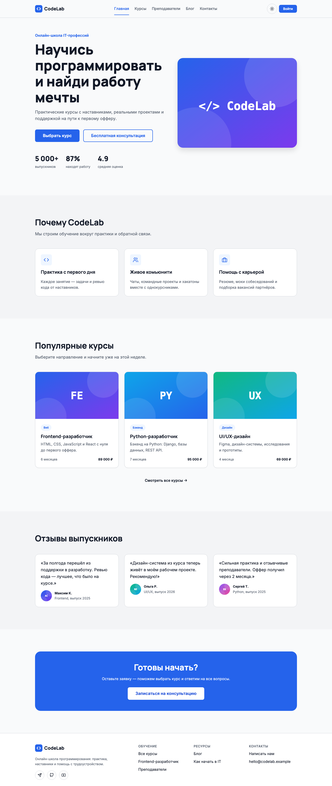 | 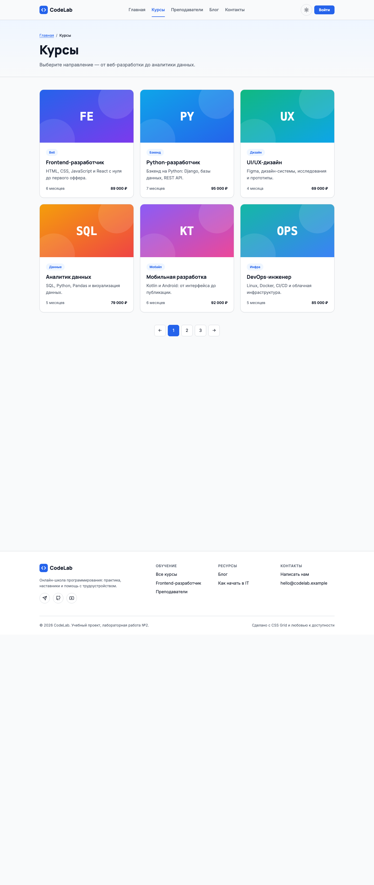 |

| Карточка курса | Преподаватели |
|---|---|
| 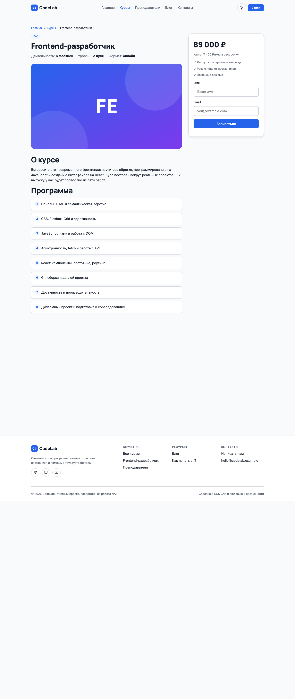 | 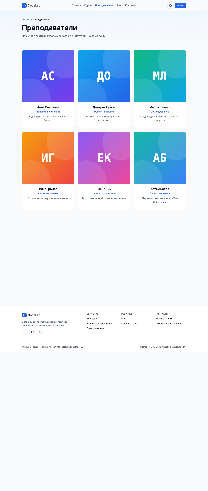 |

| Блог | Статья |
|---|---|
| 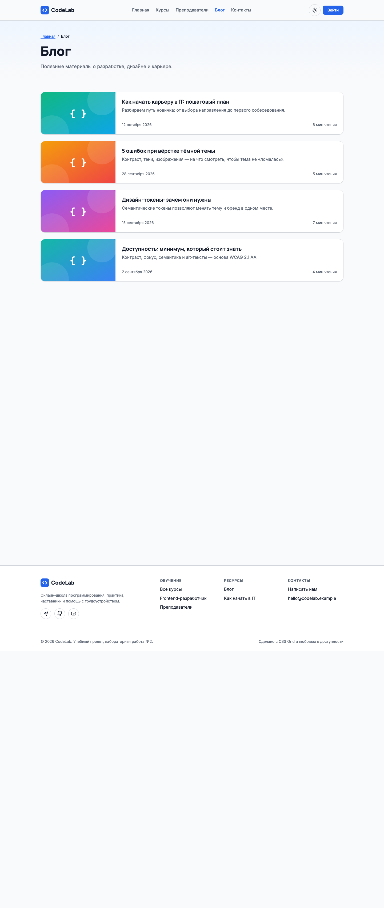 | 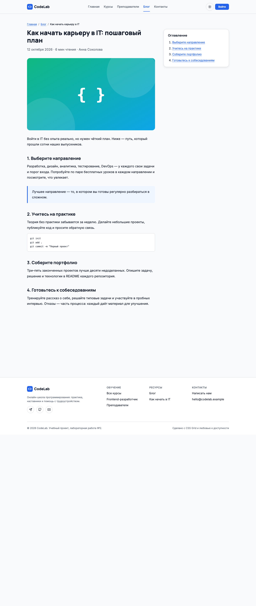 |

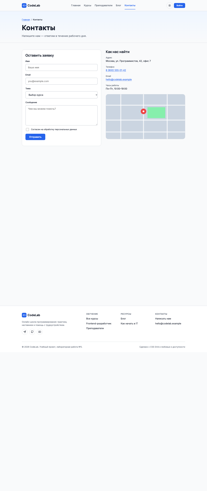

### 5.3 Планшет (768 px) — 2 колонки

| Главная | Курсы | Контакты |
|---|---|---|
| 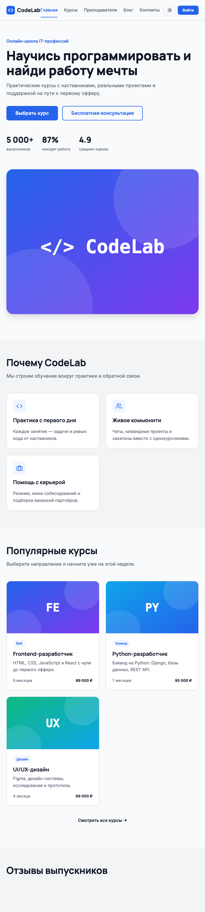 | 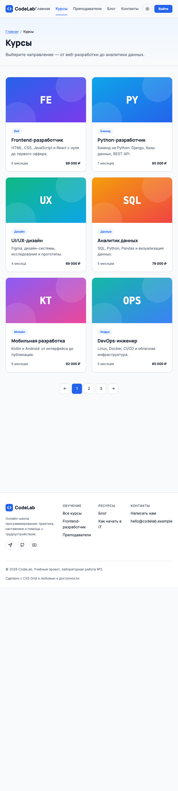 | 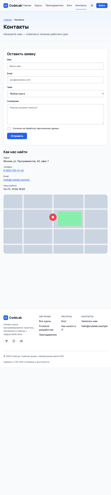 |

### 5.4 Мобильный (375 px) — 1 колонка, бургер-меню

| Главная | Курсы | Контакты | Меню открыто |
|---|---|---|---|
| 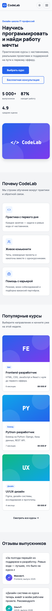 | 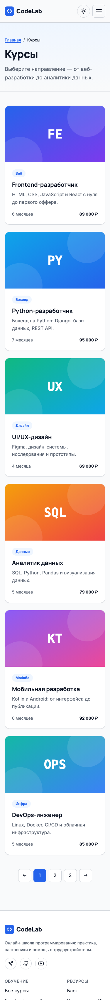 | 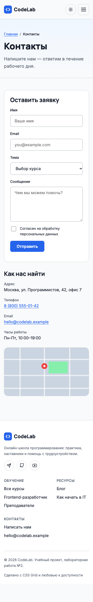 | 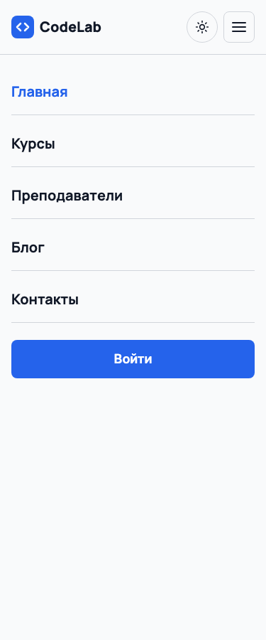 |

Адаптивность: сетки `grid--3` переходят 1 → 2 (768 px) → 3 (1024 px) колонки; шапка скрывает навигацию до 768 px; контейнер центрирован с максимумом 1200 px (на 1920 px не растягивается).

### 5.5 Тёмная тема

| Главная | Карточка курса |
|---|---|
| 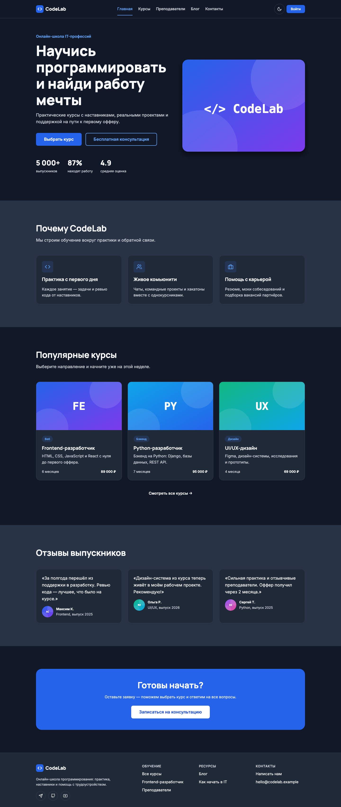 | 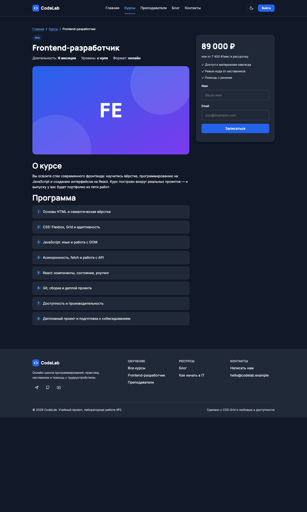 |

| Курсы | Контакты (мобильный) |
|---|---|
| 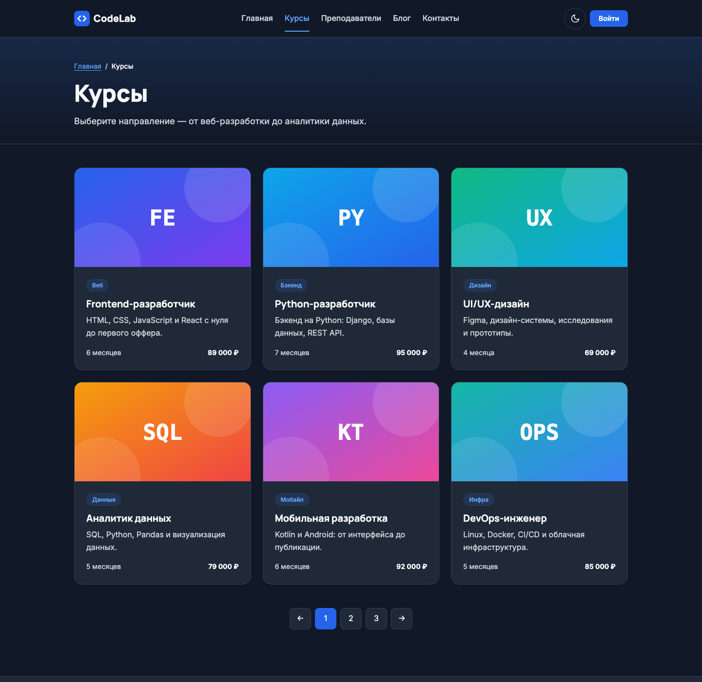 | 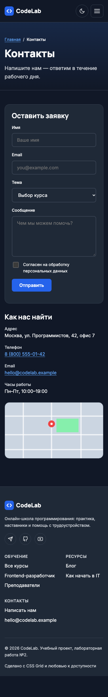 |

Логика ([theme.js](../js/theme.js)): сохранённый выбор (`localStorage`) → иначе `prefers-color-scheme`; клик по переключателю меняет только `data-theme`; пока пользователь не выбирал вручную, тема следует за системной. Inline-скрипт в `<head>` ставит тему до отрисовки (без вспышки белого). У `body` задан `transition` на `background-color` и `color`.

### 5.6 Анимации

- Hover: кнопки (подъём на 1px, смена фона), карточки (подъём на 4px + тень), ссылки меню (цвет), иконки соцсетей, пагинация, переключатель темы.
- Появление при скролле: `data-animate` + `IntersectionObserver` (threshold 0.15), каскадные задержки `--animate-delay`.
- Прогресс-бар прокрутки: `.progress` с `transform: scaleX()` (без reflow), обновляется через `requestAnimationFrame`.
- Плавный скролл по якорям: `scroll-behavior: smooth` + `scroll-padding-top` под sticky-шапку (оглавление статьи).
- Мобильное меню: выезд справа (`transform`, 400 мс), бургер превращается в крестик; закрытие по Esc, клику на ссылку и при переходе на десктоп.
- `prefers-reduced-motion: reduce` отключает переходы, анимации и smooth-scroll, а `[data-animate]` показывается сразу.

## 6. Проверки

### 6.1 Контраст текста (расчёт по формуле WCAG, подтвердить в WebAIM)

| Пара | Светлая | Тёмная |
|---|---|---|
| Основной текст / фон | 16.98 | 16.98 |
| Приглушённый текст / фон | 5.72 | 12.04 |
| Приглушённый / фон секции alt | 5.44 | — |
| Ссылка / фон | 4.95 | 6.98 |
| Ссылка / карточка | — | 5.77 |
| Белый текст / кнопка | 5.17 | 5.17 |

Все пары ≥ 4.5:1 (AA для обычного текста).

### 6.2 WAVE и Lighthouse **[СДЕЛАТЬ]**

Запустить WAVE и Lighthouse (Performance, Accessibility, Best Practices, SEO) по каждой странице и вставить скриншоты. Что уже учтено для оценки ≥ 90: `lang="ru"`, `<title>` и `meta description`, одна `h1` на странице и последовательные заголовки, `alt` у всех содержательных изображений (декоративные — `alt=""`), `width`/`height` и `loading="lazy"` (против CLS), подписи `<label>` у полей, `aria-*` у интерактивных элементов, `preconnect` и `display=swap` у шрифтов, SVG-изображения вместо тяжёлых растров.

### 6.3 Клавиатура

Tab проходит по всем элементам с видимым фокусом (`:focus-visible`, 3px outline); переключатель темы и бургер — `<button>`, работают по Enter/Space; Esc закрывает меню и возвращает фокус на бургер; skip-link ведёт к `#main`.

## 7. Вывод

**Как дизайн-система помогает поддерживать единство.** Все значения цвета, шрифтов, отступов и теней заданы токенами, а компоненты их только используют. Поэтому новая страница автоматически выглядит как остальные, а смена бренда или темы — правка в одном месте. Единый шаблон шапки и подвала в `build.py` исключает рассинхронизацию навигации.

**Трудности с тёмной темой.** (1) Белый текст на `blue-500` не проходит AA (3.68) — пришлось ввести отдельный токен `--color-btn`. (2) Синие ссылки на карточках `#1F2937` давали 3.99 — понадобился более светлый оттенок blue-400. (3) Нужно было избежать вспышки светлой темы при загрузке — ранний inline-скрипт. (4) Тени и полупрозрачные подложки в тёмной теме требуют другой плотности. (5) Приглушённый текст в светлой теме на фоне `#F3F4F6` не дотягивал до 4.5 — потемнили токен.

**Чему научился.** Строить двухуровневую систему токенов; проектировать компоненты с модификаторами и состояниями; делать адаптивные сетки на CSS Grid; использовать IntersectionObserver и `prefers-*` медиа-запросы; проверять доступность и контраст численно.

## 8. Ответы на контрольные вопросы

1. **Дизайн-система vs набор компонентов.** Система включает токены, компоненты, правила использования и принципы (иерархия, отступы, доступность); набор компонентов — только готовые «кирпичики» без общих правил.
2. **Семантические токены** называют роль (`--color-link`), а не значение (`--blue-600`). Тема или бренд меняются подменой значений, а компоненты остаются прежними.
3. **Тёмная тема на CSS-переменных:** компоненты ссылаются на `var(--color-*)`; атрибут `data-theme="dark"` переопределяет эти переменные, и весь сайт перекрашивается без JS-логики по цветам.
4. **`prefers-color-scheme`** сообщает, какую тему предпочитает ОС; по нему выбираем начальную тему и реагируем на её смену, если пользователь не выбирал вручную.
5. **`prefers-reduced-motion`** — настройка «уменьшить движение». Учитывать нужно для людей с вестибулярными нарушениями и эпилепсией (WCAG 2.3.3).
6. **IntersectionObserver** асинхронно сообщает, пересёк ли элемент границу viewport. Применяется для анимаций появления, ленивой загрузки, бесконечной ленты, аналитики просмотров, без обработчиков `scroll`.
7. **CLS** — сумма неожиданных смещений макета при загрузке. Избегаем: задаём `width`/`height` или `aspect-ratio` у изображений, `font-display: swap` с близким системным шрифтом, резервируем место под динамический контент.
8. **Контраст WCAG 2.1 AA:** ≥ 4.5:1 для обычного текста, ≥ 3:1 для крупного (от 24 px или 18.66 px жирного) и для графических элементов интерфейса.
9. **Порядок CSS:** при равной специфичности побеждает правило, которое объявлено позже. Токены нужны первыми (переменные доступны всем), base — общий reset, components переопределяет base, а pages — самые частные правила.
10. **`color-mix()`** смешивает цвета в CSS: шапка берёт `--color-bg` на 90% и прозрачность, поэтому следует за темой. **`backdrop-filter: blur()`** размывает контент за полупрозрачным элементом — эффект «матового стекла» для sticky-шапки.
